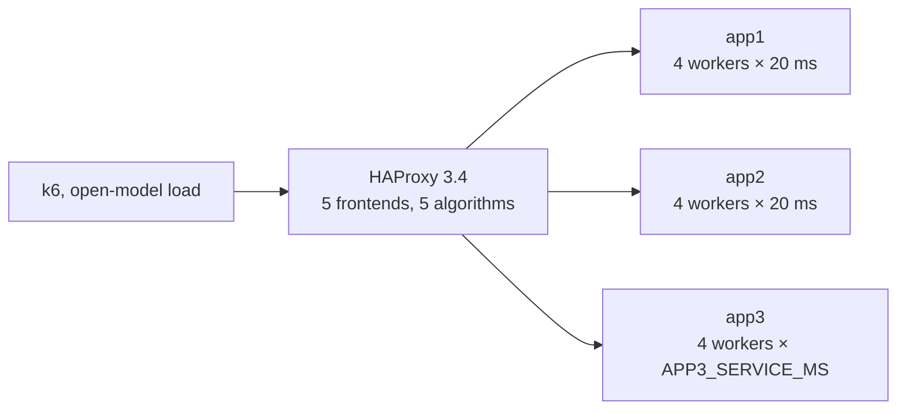

# Lab L03 — Load balancing

Unit: [SYSDESIGN-03 — Scaling compute](../../course/01-foundations/03-scaling-compute.md)

## Goal

Put HAProxy in front of three replicas of a service whose capacity you know, then measure what the lesson
claims:

- how round robin, least connections and power of two choices behave when one replica is slow;
- what happens to requests when a replica dies, with and without connection retries;
- how graceful draining turns a deploy from "some errors" into "no errors";
- how many keys move to a new replica under consistent versus modulo hashing.

## What you will observe

- With identical replicas, all three algorithms split traffic about evenly and give similar latency.
- With one replica three times slower, **round robin overloads it** (it still receives a third of the traffic).
  **Least connections** and **power of two choices** send it less, and keep p99 bounded.
- Killing a replica produces a burst of errors until health checks mark it down. Connection retries with
  redispatch remove part of that burst.
- Stopping a replica with SIGTERM and a drain period produces no errors.
- Removing one of three replicas moves about 1/3 of keys under consistent hashing and about 2/3 under modulo
  hashing.

## Prerequisites

- Docker Engine 29.x and Docker Compose v5.x (tested with Docker 29.10.0, Compose v5.8.0)
- `curl` on the host (experiment 5)
- Images (pinned): `haproxy:3.4.8-alpine` (HAProxy 3.4 LTS), `python:3.15.2-slim` (service build),
  `grafana/k6:2.4.0`
- Host ports (localhost only): 10380 round robin · 10381 least connections · 10382 power of two choices ·
  10383 consistent hash · 10384 modulo hash · 10390 HAProxy stats page and Prometheus `/metrics`

## Topology



*Diagram: k6 sends load to one HAProxy, which has five frontends (one balancing algorithm each) over the same
three replicas, app1, app2 and app3; app3's service time can be changed to make it slower.*

Each replica is the L01 service (`service/app.py`) with `WORKERS=4` and `SERVICE_MS=20`, so it can serve about
4 / 0.020 = **200 requests/s**. The three together handle about 600 requests/s. Every backend is health-checked
with `GET /health` every `HC_INTER` (default 1 s), marked down after 2 failures and up after 2 successes, and
ramped in over 5 s (`slowstart`) when it comes back.

## Run

```bash
cd labs/03-scaling-compute
docker compose -p sd-03 up -d --build
for p in 10380 10381 10382; do curl -s localhost:$p/work; echo; done
# HAProxy stats page: http://localhost:10390/

# One load test: ALGO = roundrobin | leastconn | p2c
docker compose -p sd-03 run --rm k6 run --quiet -e ALGO=roundrobin -e RATE=300 -e DURATION=30s /scripts/load.js
```

Each run prints one line:

```text
RESULT algo=… rate=… requests=… p50_ms=… p99_ms=… max_ms=… errors=<n> (<%>) split: app1=… app2=… app3=… status_502=…
```

`split` counts successful responses per replica. `status_*` counts failures by HTTP status, where `status_0`
means the connection failed or timed out.

## Experiments

1. **Baseline.** Run the load test once per algorithm (`roundrobin`, `leastconn`, `p2c`) at 300 requests/s
   (50% of total capacity). Compare split and p99.
2. **One slow replica.** Make app3 three times slower (about 67 requests/s capacity), then repeat experiment 1:
   ```bash
   APP3_SERVICE_MS=60 docker compose -p sd-03 up -d app3
   ```
   Predict first. Round robin gives app3 100 requests/s against a capacity of 67, so ρ = 1.5. What happens to its
   queue during a 30 s test? Restore with `docker compose -p sd-03 up -d app3`.
3. **Kill a replica, without and with retries.** Start a 30 s round-robin test, and after 10 s, in a second
   terminal, run `docker compose -p sd-03 kill app2` (SIGKILL). Count errors. Bring it back
   (`docker compose -p sd-03 start app2`), enable retries, and repeat:
   ```bash
   RETRIES=2 docker compose -p sd-03 up -d lb
   ```
   Which failures do retries save, and which can't they save? (Hint: a refused connection never reached the
   server. A request already in flight did.)
4. **Graceful stop, without and with draining.** With `RETRIES=0` (`docker compose -p sd-03 up -d lb`), repeat
   experiment 3 using `docker compose -p sd-03 stop app2` (SIGTERM) instead of `kill`. First with the default
   `DRAIN_S=0` (the service exits immediately), then with draining:
   ```bash
   DRAIN_S=5 docker compose -p sd-03 up -d app1 app2 app3
   ```
   With `DRAIN_S=5` the service fails `/health`, keeps serving for 5 s, answers with `Connection: close`, then
   exits.
5. **Consistent vs modulo hashing.** Map 300 keys, remove app3, map them again, and count the keys that moved:
   ```bash
   ./keymap.sh consistent 300
   ./keymap.sh mapbased 300
   ```
   The script stops app3, waits for the health check, maps the keys again, and restarts app3.

Optional: change `HC_INTER` (`HC_INTER=3s docker compose -p sd-03 up -d lb`) and repeat experiment 3 to see the
detection window grow.

## Expected results

Exact numbers depend on your machine and its load. Look for these patterns.

- **Experiment 1:** the split is about a third each for all algorithms (round robin almost exactly). p99 is
  similar across algorithms.
- **Experiment 2:** round robin still sends about a third of requests to app3, and its p99 and max latency grow
  far beyond the others (app3's queue grows for the whole test). `leastconn` and `p2c` send app3 a much smaller
  share, and keep p99 within a small multiple of the baseline.
- **Experiment 3:** errors appear while HAProxy still believes app2 is up, roughly `inter × fall` ≈ 2 s (longer when probes hang until `timeout check`, 2 s here) of
  app2's share of traffic. With retries, connection-level failures are re-dispatched to another server, at the
  cost of tail latency (each failed attempt first waits for `timeout connect`). Requests already in flight on
  app2 at the moment of the kill can still fail.
- **Experiment 4:** with `DRAIN_S=0`, SIGTERM behaves much like a kill for in-flight and in-queue requests. With
  `DRAIN_S=5`, errors should drop to zero or near zero.
- **Experiment 5:** consistent hashing moves about 1/3 of keys (exactly the ones that were on app3). Modulo
  hashing moves noticeably more, around 2/3.

## Clean up

```bash
docker compose -p sd-03 --profile tools down -v
docker image rm sd-03-service:local   # optional
```

## Cost

€0. Everything runs locally. No cloud resources.

## Test status

**runtime-tested** on 2026-11-20. Host: Ubuntu 24.04.5 LTS, kernel 7.0.0-43-generic, 12 CPUs, 30 GB RAM,
Docker 29.10.0, Compose v5.8.0. Images: `haproxy:3.4.8-alpine` (`HAProxy version 3.4.8-1b15b69 2026/11/18`),
`grafana/k6:2.4.0`, and `python:3.15.2-slim`. The HAProxy and k6 images were pulled through `mirror.gcr.io`
because Docker Hub pulls were stalling; their digests are identical to Docker Hub's. The host was shared with
other workloads (load average about 7–20 on 12 CPUs), and the whole experiment set was run twice with
consistent results. Numbers below are from the final run, with the configuration as shipped.

| Experiment | Algorithm / setting | Split app1 / app2 / app3 | p50 | p99 | Errors |
|---|---|---|---|---|---|
| 1 Baseline, 300 req/s | roundrobin | 3000 / 3001 / 2999 | 44.0 ms | 123 ms | 0 |
| | leastconn | 3019 / 2992 / 2989 | 47.7 ms | 126 ms | 0 |
| | p2c (`random(2)`) | 3010 / 2926 / 3065 | 45.0 ms | 121 ms | 0 |
| 2 app3 3× slower | roundrobin | 2832 / 2831 / 2832 (8,495 of 9,000 completed in the test window) | 58.9 ms | **11,466 ms** | 0 |
| | leastconn | 3557 / 3580 / 1863 | 51.1 ms | 228 ms | 0 |
| | p2c | 3554 / 3473 / 1974 | 50.2 ms | 255 ms | 0 |
| 3a `kill app2` at t = 10 s | `RETRIES=0` | 3986 / 941 / 3986 | 42.3 ms | 166 ms | **87 × 503** (0.97%) |
| 3b `kill app2` at t = 10 s | `RETRIES=2` + redispatch | 4022 / 957 / 4022 | 40.0 ms | **1,070 ms** | 0 |
| 4a `stop app2` (SIGTERM), `DRAIN_S=0` | `RETRIES=0` | 4009 / 948 / 4008 | 37.2 ms | 149 ms | **36 × 503** (0.40%) |
| 4b `stop app2` (SIGTERM), `DRAIN_S=5` | `RETRIES=0` | 3954 / 1093 / 3954 | 42.8 ms | 125 ms | **0** |

Experiment 5 (300 keys, app3 removed):
- **Consistent hash:** 109 keys were on app3, and **109 moved**, exactly app3's keys.
- **Map-based (modulo) hash:** 102 were on app3, and **199 moved** (66%).

What the runs showed:
- With one replica slow, round robin's p99 exploded to 11.5 s while least connections and P2C kept it at about
  0.23–0.26 s, by sending app3 about 21% of requests instead of 33%.
- Connection retries turned the 87 kill errors into zero errors, but they paid for it in tail latency (p99
  about 1.07 s). That p99 is consistent with the 1 s `timeout connect` (and HAProxy's documented turn-around
  timer of min(`timeout connect`, 1 s) before a retry): failed attempts appear to wait about 1 s before being
  re-dispatched. That is our reading of the numbers, not something we traced packet by packet. The retries traded errors for
  latency.
- Draining (`DRAIN_S=5`) removed the errors that an immediate exit caused.

**Anomalies found while testing, and fixed in the shipped config:**
1. The first run had no `timeout check`. During a moment of host overload, *every* server failed its 1 s
   health check at once, HAProxy marked whole backends DOWN, and 445 requests got `503`. That is a live example
   of the lesson's fleet-wide health-check failure. The config now sets `timeout check 2s`.
2. Without a `resolvers` section, HAProxy resolved `app1`…`app3` only at start-up. After containers were
   recreated, a stopped `app3` stayed "UP" because its old IP now belonged to another container. The config now
   re-resolves through Docker's DNS.

The baseline p50 of about 44 ms is above the roughly 14 ms you would expect from a 20 ms-mean exponential service
at ρ = 0.5 per replica. A direct 100 requests/s run against one replica (bypassing HAProxy) measured p50 14.7 ms,
and 100 requests/s through HAProxy measured 16.9 ms. So the extra latency at 300 requests/s came from
load-dependent overhead on the shared host (proxy, k6 and Python threads), not from queueing at the replicas.
Compare algorithms *within* one run, not absolute values across machines.

Torn down with `docker compose -p sd-03 --profile tools down -v`. No sd-03 containers or volumes remained.

## Troubleshooting

- **`status_0` errors in the baseline:** k6 timed out or the host is overloaded. Check `docker stats`, and lower
  `RATE`.
- **HAProxy won't start (`parsing [...] : unknown keyword`):** you are not on HAProxy 3.x. The config relies on
  environment variables in double quotes (`"${RETRIES}"`) and on `balance random(2)`.
- **`keymap.sh` shows 0 keys moved:** app3 was not yet marked down. Increase the `sleep` in the script, or check
  the stats page at http://localhost:10390/.
- **Image pulls hang:** the registry is busy or rate-limited. Pull the images one by one. `mirror.gcr.io` serves
  the same Docker Hub image digests, for example `mirror.gcr.io/library/haproxy:3.4.8-alpine`.
