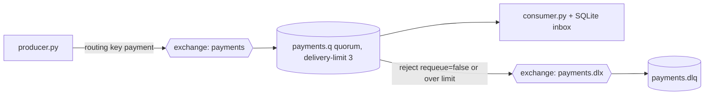

# L08 — Queues, poison messages, DLQ and the idempotent consumer

Lab for [SYSDESIGN-08 — Asynchronous & event-driven systems](../../course/01-foundations/08-async-event-driven.md).

## Goal

See for yourself that **at-least-once delivery produces duplicates**, and that an **inbox (dedup) table** committed
in the same transaction as the effect turns them into exactly-once *effects*. Then watch a **poison message** and an
**always-failing message** leave the main queue through a **dead-letter exchange**, each with a different
`x-death` reason.

## What you will observe

- A payment ledger (SQLite, inside the consumer's volume) fed by a RabbitMQ **quorum queue**.
- A consumer that **crashes after committing but before acking**. RabbitMQ redelivers the message
  (`redelivered=True`), and Compose restarts the consumer.
- A **producer-side duplicate** (the same `message_id` published twice, simulating a retry after a lost confirm).
- With `IDEMPOTENT=1`, the balance is correct and duplicates are logged as `DUPLICATE skipped`.
  With `IDEMPOTENT=0`, the same run gives a wrong balance.
- An unparseable message rejected with `requeue=False`, which goes straight to `payments.dlq` with
  `reason=rejected`.
- A message that always throws, retried with `basic_reject(requeue=True)` until the queue's `x-delivery-limit`
  (3 in this lab), then dead-lettered with `reason=delivery_limit`.
- Optional: a backlog building up behind a slow consumer (queue depth as a stand-in for lag), and prefetch as
  backpressure.

Topology:



*Diagram: the producer publishes to the payments exchange, which routes to the quorum queue payments.q consumed by
consumer.py; rejected or over-limit messages go via the payments.dlx exchange to payments.dlq.*

## Prerequisites

- Docker Engine 29.x with Docker Compose v2 plugin (tested with Docker 29.10.0, Compose v5.8.0).
- About 300 MB of disk for images. No GPU, no cloud account.
- Images (pinned): `rabbitmq:4.4.1-management-alpine`, `python:3.15.2-slim` with `pika==1.5.0`.
- Host ports **10815** (management UI) and **10856** (AMQP) must be free.

## Run

All commands run from this directory.

```bash
# 1. Start RabbitMQ and the consumer (idempotent mode), crashing once on pay-0005
CRASH_ONCE_ON=pay-0005 docker compose -p sd-08 up -d --build

# 2. Publish 10 payments of 10 to account A, plus a duplicate of pay-0003
docker compose -p sd-08 run --rm tools python producer.py --payments 10 --duplicate

# 3. Read the consumer log and the ledger
docker compose -p sd-08 logs consumer
docker compose -p sd-08 run --rm tools python report.py
```

The management UI is at <http://localhost:10815> (user `guest`, password `guest`; local lab only).

## Experiments

1. **Idempotent consumer under duplicates and a crash.** Run the steps above. In the log, look for
   `CRASH after committing pay-0005`, a restart, then `OK pay-0005 DUPLICATE skipped (redelivered=True …)`, and
   `OK pay-0003 DUPLICATE skipped` for the producer duplicate. `report.py` should show `balance[A] = 100`, with
   effects applied = 10 and inbox rows = 10, and both queues empty.

2. **Naive consumer.** Reset and repeat without the inbox:

   ```bash
   docker compose -p sd-08 down -v
   IDEMPOTENT=0 CRASH_ONCE_ON=pay-0005 docker compose -p sd-08 up -d --build
   docker compose -p sd-08 run --rm tools python producer.py --payments 10 --duplicate
   docker compose -p sd-08 run --rm tools python report.py
   ```

   Ten distinct payments now produce **12 applied effects** (one producer duplicate plus one redelivery after the
   crash), and the balance is wrong. At-least-once delivery is working exactly as designed. The consumer is the
   bug.

3. **Poison and always-failing messages.** With the stack from experiment 1 running:

   ```bash
   docker compose -p sd-08 run --rm tools python producer.py --poison --always-fail
   docker compose -p sd-08 logs consumer | tail -n 8
   docker compose -p sd-08 run --rm tools python dlq_inspect.py
   ```

   Expect one `POISON poison-0001 … -> DLQ` line, several `FAIL fail-0001 (x-delivery-count=N)` lines with N
   increasing, and then two DLQ entries: `reason=rejected` (poison) and `reason=delivery_limit` (always-fail).

4. **What counts as a failure (RabbitMQ 4.3+).** Restart the consumer so that it retries with
   `basic_nack(requeue=True)` instead of `basic_reject(requeue=True)`, and publish another always-failing message:

   ```bash
   RETRY_VERB=nack docker compose -p sd-08 up -d consumer
   docker compose -p sd-08 run --rm tools python producer.py --always-fail
   docker compose -p sd-08 logs -f consumer      # Ctrl-C after ~10 s
   docker compose -p sd-08 stop consumer         # the loop never ends on its own
   ```

   Watch `x-delivery-count`, and check whether `fail-0001` ever reaches the DLQ. Compare with the
   [quorum queue documentation](https://www.rabbitmq.com/docs/quorum-queues) on which outcomes increment the
   delivery count. (The consumer sleeps 200 ms per nack in this mode so the loop does not flood your terminal.)

5. **Backlog and backpressure.** Make the consumer slow and publish a burst:

   ```bash
   docker compose -p sd-08 down -v                      # start from an empty ledger and queue
   WORK_MS=50 PREFETCH=5 docker compose -p sd-08 up -d
   docker compose -p sd-08 run --rm tools python producer.py --payments 500 --start 1000
   docker compose -p sd-08 run --rm tools python report.py   # repeat a few times
   ```

   `ready` on `payments.q` jumps and then drains at about 1 / 50 ms = 20 messages/s. With `PREFETCH=5` the broker
   never has more than 5 unacknowledged deliveries outstanding on the consumer's channel (visible as "Unacked" in
   the management UI). Compute the expected drain time before you look.

## Expected results

- Experiment 1: correct balance (100) despite one crash-before-ack and one duplicate publish. Exactly 10 effects.
  Note that the crash causes redelivery of **every** unacknowledged message in the prefetch window, not just
  `pay-0005`. All of them arrive with `redelivered=True`.
- Experiment 2: more effects than distinct payments (12 for 10), and a balance above 100.
- Experiment 3: two DLQ messages with different `x-death` reasons. The main queue is empty, so the consumer is not
  stuck. With `x-delivery-limit: 3`, `fail-0001` is delivered four times (delivery counts 0, 1, 2, 3) before it
  is dead-lettered.
- Experiment 4: on RabbitMQ 4.3+, `x-delivery-count` stays at 0 and `fail-0001` is never dead-lettered. The
  consumer loops until you stop it.
- Experiment 5: drain rate close to the value you computed from `WORK_MS`.

These describe what to look for. Your exact log interleaving and timings will differ.

## Clean up

```bash
docker compose -p sd-08 down -v
# optional: remove the images
docker image rm sd-08-consumer sd-08-tools rabbitmq:4.4.1-management-alpine python:3.15.2-slim
```

## Cost

€0. Everything runs locally in containers.

## Test status

**runtime-tested**, 2026-11-19/20 (one session).

- Host: Ubuntu 24.04, Linux kernel 7.0.0-43-generic, x86_64. Docker Engine 29.10.0, Docker Compose v5.8.0.
- Images: `rabbitmq:4.4.1-management-alpine` (broker reported RabbitMQ 4.4.1, Erlang 29.1.2),
  `python:3.15.2-slim` with `pika==1.5.0`.
- Queue verified via the management API: `type quorum`, arguments `x-dead-letter-exchange=payments.dlx`,
  `x-delivery-limit=3`, `x-queue-type=quorum`.

Observed output (summarised):

| Experiment | Observed |
|---|---|
| 1 (idempotent, crash on pay-0005, duplicate pay-0003) | `CRASH after committing pay-0005, before ack`; restart; `OK pay-0005 DUPLICATE skipped (redelivered=True, x-delivery-count=1)`; `OK pay-0003 DUPLICATE skipped`; report: `balance[A] = 100`, `effects applied = 10`, `inbox rows = 10`, both queues `ready=0` |
| 2 (naive, same inputs) | pay-0005 and pay-0003 applied twice; report: `balance[A] = 120`, `effects applied = 12`, `inbox rows = 0` |
| 3 (poison + always-fail) | `POISON poison-0001 … -> DLQ`; `FAIL fail-0001` at `x-delivery-count` 0, 1, 2, 3; DLQ: `poison-0001 reason=rejected`, `fail-0001 reason=delivery_limit`; `payments.q ready=0`, `payments.dlq ready=2` |
| 4 (`RETRY_VERB=nack`) | 45 `FAIL fail-0001 (x-delivery-count=0) … nack(requeue=True)` lines in about 10 s; never dead-lettered; DLQ empty; consumer stopped manually |
| 5 (`WORK_MS=50`, `PREFETCH=5`, 500 messages) | `ready` 400 → 248 → 115 → 0 at about 7 s, 15 s, 24 s, 31 s after publishing started, i.e. about 19 messages/s against the expected 20/s; final `balance[A] = 5000`, `effects applied = 500` |

Torn down with `docker compose -p sd-08 down -v` afterwards. Interleaving and timings will vary on your machine.

## Troubleshooting

- **`port is already allocated`.** Another process uses 10815 or 10856. Change the left-hand side of the port
  mapping in `compose.yaml`. The lab does not need host ports except for the UI.
- **Consumer logs `broker not reachable yet`.** RabbitMQ is still booting. The consumer retries for about a
  minute. Compose also waits for the broker's health check.
- **Experiment 1 shows no crash.** The crash happens only once per volume, because a marker file
  `/data/crashed-pay-0005` is kept. Run `docker compose -p sd-08 down -v` to reset.
- **`PRECONDITION_FAILED - inequivalent arg`.** You changed queue arguments (for example `DELIVERY_LIMIT`)
  against an existing queue. Reset with `down -v`.
- **Balances accumulate across experiments.** The ledger lives in the `ledger` volume. Reset with `down -v`.
