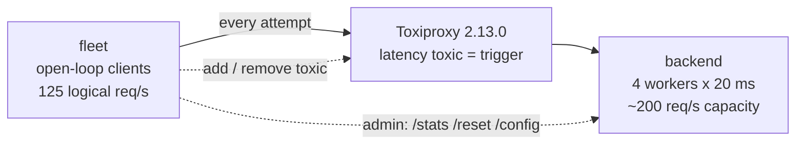

# Lab L11 — Retry storm

Unit: [SYSDESIGN-11 Reliability engineering](../../course/01-foundations/11-reliability-engineering.md)

## Goal

Reproduce a **metastable failure** on a laptop: a short trigger (5 seconds of extra network latency) that leaves a
healthy service *down after the trigger is gone* because of the client retry policy — and then show which
protections let it recover: retry budgets with a circuit breaker on the client, or deadline-aware load shedding on
the server.

## What you will observe



*Diagram: the client fleet sends every attempt through Toxiproxy to a capacity-limited backend; the fleet also talks
to Toxiproxy's API to add and remove the latency trigger and to the backend's separate admin port to read counters.*

- The backend has 4 worker slots and spends 20 ms per request, so it can serve about **200 req/s**. Requests that
  cannot get a slot wait in an unbounded FIFO queue (the "hidden queue").
- The fleet offers **125 new logical requests per second** (62.5% of capacity) no matter what (an *open* system: users keep arriving).
  Each attempt has a **200 ms** timeout and carries an absolute deadline header.
- Each scenario runs **5 s baseline → 5 s trigger → 15 s after**. The trigger is a Toxiproxy `latency` toxic of
  **+300 ms** on the response path, so every attempt during the trigger times out.
- Five policies face the same trigger:

| Scenario | Client policy | Server policy |
|---|---|---|
| `none` | one attempt, no retries | unbounded queue |
| `naive` | up to 3 immediate retries (4 attempts) | unbounded queue |
| `backoff` | up to 3 retries, capped exponential backoff with full jitter (base 100 ms, cap 2 s) | unbounded queue |
| `budget` | backoff + jitter + retry budget (token bucket: +0.1 token per request, −1 per retry) + circuit breaker (opens at ≥ 50% failures over ≥ 20 calls in 1 s; 1 s cool-down; 5 half-open probes) | unbounded queue |
| `shed` | naive retries (4 attempts) | rejects with `503` any request that cannot start in time to meet its deadline |

The fleet prints one JSON line per scenario and a summary table: success rate per phase, backend arrivals per
second, attempts per logical request during the trigger (amplification), **wasted** work (requests the backend
finished after the caller's deadline — throughput that was not goodput), shed count, maximum queue depth, and the
latency of successful requests.

## Prerequisites

- Docker Engine with Compose v2+ (tested with Docker 29.10.0 and Compose v5.8.0).
- Images (pulled automatically): `python:3.15.2-slim` (backend and fleet; standard library only, nothing installed)
  and `ghcr.io/shopify/toxiproxy:2.13.0`.
- About 3 minutes per full run. Free host ports `11166`, `11174`, `11180`, `11181` (bound to `127.0.0.1` only).

## Run

```bash
cd labs/11-reliability-engineering
docker compose -p sd-11 up -d --wait          # backend + toxiproxy
docker compose -p sd-11 run --rm fleet        # all five scenarios (~2.5-3 min)
```

Run a subset, or change parameters, with arguments and environment variables:

```bash
docker compose -p sd-11 run --rm fleet python -u /app/fleet.py none naive
docker compose -p sd-11 run --rm -e RPS=40 fleet python -u /app/fleet.py naive
```

Useful knobs (fleet): `RPS`, `TIMEOUT_MS`, `TOXIC_LATENCY_MS`, `BASELINE_S`, `TRIGGER_S`, `AFTER_S`, `MAX_ATTEMPTS`,
`BACKOFF_BASE_MS`, `BACKOFF_CAP_MS`, `SEED`. Backend: `WORKERS`, `SERVICE_MS` (edit `compose.yaml`).

Poke the pieces by hand while the stack is up:

```bash
curl -s localhost:11181/stats                      # backend counters (admin port)
curl -s localhost:11174/proxies                    # Toxiproxy state
curl -s -X POST localhost:11174/proxies/backend/toxics \
  -d '{"name":"trigger","type":"latency","stream":"downstream","attributes":{"latency":300}}'
curl -s -X DELETE localhost:11174/proxies/backend/toxics/trigger
```

(The `backend` proxy exists after the first fleet run; the fleet creates it through the Toxiproxy API.)

## Experiments

1. **Baseline the five policies.** Run all scenarios. For each, read the `after5-15` success column: did the system
   come back once the trigger was removed?
2. **Find the vulnerable region.** Rerun `naive` with `RPS=40`, `RPS=60` and `RPS=100`. Four attempts per request
   times the offered load, compared with ~200 req/s of capacity, predicts whether the system can recover. Does it?
3. **Make the trigger shorter.** `TRIGGER_S=1` with `naive`. Is a one-second blip enough to tip it?
4. **Backoff without a budget.** Compare `backoff` with `budget`. Then try `BACKOFF_CAP_MS=10000` for `backoff`:
   does a larger cap fix it, or only delay the extra attempts?
5. **Where is the queue?** During a `naive` run, watch `curl -s localhost:11181/stats` once per second: `queued`
   (threads waiting for a slot) climbs while `served` stays near 200/s. The backend is busy — and almost all of that
   work is `wasted`.
6. **Deadline propagation.** In `backend.py`, the shed decision uses the caller's *absolute* deadline. Why would
   using "time since the handler started" miss part of the queue? (Hint: the kernel's accept backlog.)

## Expected results

These are qualitative expectations; your exact numbers depend on the host. The run recorded under *Test status* is
the reference.

- `none`: success near 100% before and after, near 0% during the trigger; backend load flat at the offered rate;
  nothing wasted. The trigger only hurts while it lasts.
- `naive`: amplification close to 4 during the trigger; the backend queue grows past what can be served within the
  timeout; success stays near 0% **after** the trigger is removed while the backend keeps serving at full capacity —
  a metastable failure. The `wasted` counter is large.
- `backoff`: jitter spreads the retries, but in an open system the extra attempts still arrive; expect it to remain
  degraded much like `naive` (it did in the recorded run).
- `budget`: the breaker opens within the first second of the trigger and attempts fall *below* the offered load;
  success recovers within a few seconds after the trigger ends.
- `shed`: amplification is still near 4 during the trigger, but the server spends little capacity on late work, so
  the queue stays short and success recovers after the trigger ends — more slowly than `budget`, because the clients
  are still amplifying.

## Clean up

```bash
docker compose -p sd-11 down -v
# optional: docker image rm ghcr.io/shopify/toxiproxy:2.13.0 python:3.15.2-slim
```

## Cost

€0 — runs locally. No cloud resources.

## Test status

**runtime-tested** — 2026-11-20 (local time; started 2026-11-19 UTC), host Ubuntu 24.04 (kernel 7.0.0-43, x86_64),
Docker 29.10.0, Docker Compose v5.8.0, images `python:3.15.2-slim` (Python 3.15.2) and
`ghcr.io/shopify/toxiproxy:2.13.0`. Command: `docker compose -p sd-11 up -d --wait && docker compose -p sd-11 run --rm fleet`
with the committed defaults (4 workers × 20 ms, 125 req/s, 200 ms timeout, +300 ms toxic for 5 s). The host was
heavily loaded by other workloads during the run (load average ≈ 30–40), so treat absolute latencies as noisy.

Observed summary table (one run, seed 11):

```text
scenario  | success % base/trig/after0-5/after5-15 | backend req/s base/trig/after5-15 | amp trig | wasted | shed | maxQ
none      | 99.5/4.0/100.0/100.0                   | 125/125/125                       | 1.0      | 0      | 0    | 1
naive     | 99.5/0.0/0.0/0.0                       | 125/392/179                       | 3.77     | 3435   | 0    | 1016
backoff   | 99.5/0.0/0.0/0.0                       | 125/391/185                       | 3.56     | 3481   | 0    | 1016
budget    | 99.5/0.0/93.6/100.0                    | 125/19/125                        | 0.16     | 0      | 0    | 3
shed      | 99.5/0.0/0.0/84.1                      | 125/412/257                       | 3.77     | 275    | 5280 | 85
```

What this run showed:

- `naive` and `backoff` stayed at **0% success for the full 15 s after the trigger was removed**, while the backend
  kept serving at roughly its capacity (179–185 req/s against ~200) — almost all of it late, wasted work. A
  metastable failure, reproduced.
- `budget`: the circuit breaker opened 0.55 s into the trigger, cycled open/half-open while the toxic was present,
  and closed 0.36 s after the trigger ended (breaker transitions `[5.55 open] … [10.3 half-open] [10.36 closed]`);
  backend load *dropped* to 19 req/s during the trigger and success was back to 93.6% in the first 5 s.
- `shed`: the server rejected 5,280 doomed requests, kept its queue short (max 85) and recovered to 84.1% in the
  5–15 s window — but not in the first 5 s, because the clients still sent ~4 attempts per request. Server-side
  shedding protects the server; only the client-side budget removed the amplification itself.
- Every client failure in `none`/`naive`/`backoff` was a timeout (`attempt_failures`), with no client-side socket
  errors, so the failures came from the trigger and the overloaded backend rather than from the load generator.

Earlier development runs on the same host exposed lab bugs that are now fixed (control requests queued behind the
overloaded listener — hence the separate admin port; per-attempt DNS lookups and ephemeral-port exhaustion — see
*Troubleshooting*; a 50 ms polling wait in the backend queue that starved the interpreter lock). The `maxQ` ceiling of ~1,016 reflects the container's default
1,024 open-file limit: beyond it, connections wait in the kernel accept backlog — another hidden queue.

## Troubleshooting

- **Port already in use**: another process holds 11166/11174/11180/11181. Change the left-hand side of the `ports`
  entries in `compose.yaml`.
- **`backend` unhealthy**: check `docker compose -p sd-11 logs backend`; the backend needs only the Python standard
  library.
- **Every scenario fails even at baseline**: the host is too slow for the offered rate of new TCP connections. Lower `RPS`
  (and keep it below the backend capacity, `WORKERS × 1000 / SERVICE_MS`).
- **Results vary between runs**: the boundary of the vulnerable region is sensitive to host speed. Compare scenarios
  within one run, and repeat a run before drawing conclusions.
- **`OSError:EADDRNOTAVAIL` in `attempt_failures`**: the client ran out of ephemeral ports. Each client-side
  timeout leaves a socket in TIME_WAIT; a retry storm opens tens of thousands of short connections. `compose.yaml`
  widens the port range and enables `tcp_tw_reuse` for the fleet and Toxiproxy (namespaced sysctls). If your
  runtime refuses the sysctls, remove them and lower `RPS` or run fewer scenarios per invocation.
- **Fleet DNS**: the fleet resolves `toxiproxy` once per scenario. Resolving the name on every connection sends a DNS
  lookup through asyncio's small default thread pool per attempt, and under a retry storm that pool, not the backend,
  becomes the bottleneck (we hit exactly this while building the lab).
